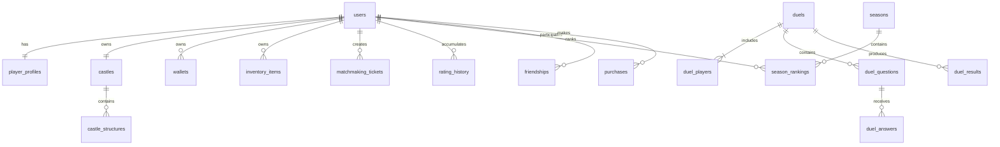

# KALE DÜELLOSU — DATABASE SPECIFICATION

## 1. Database conventions

- PostgreSQL is the durable source of truth.
- Use UUID primary keys for user-generated/domain entities.
- Use `timestamptz` in UTC.
- Store currency and damage as integers in smallest game units.
- Use immutable ledgers for currency and inventory changes.
- Add `created_at` and `updated_at` where appropriate.
- Use explicit status enums or constrained text values.
- Index foreign keys and common query filters.
- Avoid cascading deletion of financial, match, or audit history.
- Use soft deletion only where recovery/audit requirements justify it.

## 2. Core entity relationships

## 3. Identity and profile tables

### users
- `id UUID PRIMARY KEY`
- `email_normalized TEXT UNIQUE NULL`
- `username_normalized TEXT UNIQUE NOT NULL`
- `username_display TEXT NOT NULL`
- `password_hash TEXT NULL`
- `status TEXT NOT NULL`
- `email_verified_at TIMESTAMPTZ NULL`
- `created_at`, `updated_at`, `deleted_at`

Do not store plaintext passwords. External identity provider identifiers should be stored in a separate identity table.

### user_identities
- `id UUID PK`
- `user_id UUID FK users`
- `provider TEXT`
- `provider_subject TEXT`
- unique(provider, provider_subject)

### user_sessions
- `id UUID PK`
- `user_id UUID FK`
- `refresh_token_hash TEXT`
- `expires_at TIMESTAMPTZ`
- `revoked_at TIMESTAMPTZ NULL`
- `created_at TIMESTAMPTZ`

### player_profiles
- `user_id UUID PK/FK`
- `player_level INT`
- `player_xp BIGINT`
- `avatar_key TEXT`
- `bio TEXT NULL`
- `locale TEXT`
- `privacy_settings JSONB`
- `created_at`, `updated_at`

### player_statistics
- `user_id UUID PK/FK`
- `duels_played BIGINT`
- `wins BIGINT`
- `losses BIGINT`
- `draws BIGINT`
- `correct_answers BIGINT`
- `total_answers BIGINT`
- `total_correct_response_ms BIGINT`
- `best_streak INT`
- `updated_at`

Statistics are derived from validated events and may be rebuilt.

## 4. Castle tables

### castles
- `id UUID PK`
- `user_id UUID UNIQUE FK users`
- `castle_level INT`
- `durability INT`
- `max_durability INT`
- `defense_rating INT`
- `theme_key TEXT`
- `protection_until TIMESTAMPTZ NULL`
- `version BIGINT`
- `created_at`, `updated_at`

### structure_definitions
- `id UUID PK`
- `structure_key TEXT UNIQUE`
- `display_name_key TEXT`
- `max_level INT`
- `base_durability INT`
- `base_cost JSONB`
- `upgrade_rules JSONB`
- `defense_attributes JSONB`
- `unlock_rules JSONB`
- `asset_key TEXT`
- `active BOOLEAN`

### castle_structures
- `id UUID PK`
- `castle_id UUID FK castles`
- `definition_id UUID FK structure_definitions`
- `level INT`
- `durability INT`
- `max_durability INT`
- `slot_key TEXT`
- `status TEXT`
- `version BIGINT`
- `created_at`, `updated_at`
- unique(castle_id, slot_key)

### castle_damage_events
- `id UUID PK`
- `castle_id UUID FK castles`
- `structure_id UUID NULL FK castle_structures`
- `duel_id UUID FK duels`
- `attacker_user_id UUID FK users`
- `damage_amount INT`
- `damage_type TEXT`
- `combat_event_id UUID UNIQUE`
- `created_at`

### castle_repairs
- `id UUID PK`
- `castle_id UUID FK castles`
- `structure_id UUID NULL FK castle_structures`
- `user_id UUID FK users`
- `durability_restored INT`
- `resource_cost JSONB`
- `idempotency_key TEXT UNIQUE`
- `created_at`

## 5. Duel and question tables

### duels
- `id UUID PK`
- `mode TEXT` — ranked/friendly
- `status TEXT`
- `winner_user_id UUID NULL FK users`
- `result_type TEXT NULL`
- `question_count INT`
- `started_at TIMESTAMPTZ NULL`
- `ended_at TIMESTAMPTZ NULL`
- `rules_snapshot JSONB`
- `created_at`

### duel_players
- `id UUID PK`
- `duel_id UUID FK duels`
- `user_id UUID FK users`
- `rating_before INT NULL`
- `rating_after INT NULL`
- `score INT`
- `correct_count INT`
- `response_time_total_ms BIGINT`
- `ready_at TIMESTAMPTZ NULL`
- `connection_state TEXT`
- unique(duel_id, user_id)

### questions
- `id UUID PK`
- `category_id UUID FK question_categories`
- `question_type TEXT`
- `difficulty TEXT`
- `status TEXT`
- `media_key TEXT NULL`
- `created_at`, `updated_at`

### question_versions
- `id UUID PK`
- `question_id UUID FK questions`
- `version INT`
- `locale TEXT`
- `prompt TEXT`
- `options JSONB`
- `answer_key JSONB`
- `explanation TEXT NULL`
- `published_at TIMESTAMPTZ NULL`
- unique(question_id, version, locale)

Answer keys must never be included in pre-resolution client responses.

### question_categories
- `id UUID PK`
- `category_key TEXT UNIQUE`
- `display_name_key TEXT`

### duel_questions
- `id UUID PK`
- `duel_id UUID FK duels`
- `round_number INT`
- `question_version_id UUID FK question_versions`
- `deadline_at TIMESTAMPTZ`
- `resolved_at TIMESTAMPTZ NULL`
- unique(duel_id, round_number)

### duel_answers
- `id UUID PK`
- `duel_question_id UUID FK duel_questions`
- `user_id UUID FK users`
- `answer_payload JSONB`
- `received_at TIMESTAMPTZ`
- `response_time_ms INT`
- `is_correct BOOLEAN NULL`
- `score_awarded INT`
- unique(duel_question_id, user_id)

### duel_results
- `id UUID PK`
- `duel_id UUID UNIQUE FK duels`
- `result_payload JSONB`
- `processed_at TIMESTAMPTZ`
- `idempotency_key TEXT UNIQUE`

## 6. Matchmaking tables

### matchmaking_tickets
- `id UUID PK`
- `user_id UUID FK users`
- `mode TEXT`
- `rating INT`
- `league_key TEXT`
- `castle_power INT`
- `region_key TEXT`
- `status TEXT`
- `search_started_at TIMESTAMPTZ`
- `expires_at TIMESTAMPTZ`
- `created_at`, `updated_at`

Partial unique index: one active ticket per user.

### matchmaking_matches
- `id UUID PK`
- `ticket_a_id UUID FK matchmaking_tickets`
- `ticket_b_id UUID FK matchmaking_tickets`
- `duel_id UUID NULL FK duels`
- `status TEXT`
- `confirmation_deadline TIMESTAMPTZ`
- `created_at`, `updated_at`

Reservation must be atomic and prevent a user being reserved twice.

### matchmaking_history
- `id UUID PK`
- `user_id UUID FK users`
- `ticket_id UUID FK matchmaking_tickets`
- `opponent_rating INT NULL`
- `rating_gap INT NULL`
- `wait_ms INT`
- `outcome TEXT`
- `created_at`

## 7. Economy and inventory tables

### wallets
- `user_id UUID PK/FK users`
- `gold BIGINT`
- `stone BIGINT`
- `crystals BIGINT`
- `version BIGINT`
- `updated_at`

Wallet balances are materialized totals; ledger is authoritative for audit/reconciliation.

### currency_transactions
- `id UUID PK`
- `user_id UUID FK users`
- `currency_type TEXT`
- `amount BIGINT` (positive credit, negative debit)
- `reason TEXT`
- `reference_type TEXT`
- `reference_id UUID NULL`
- `idempotency_key TEXT UNIQUE`
- `created_at`

### item_definitions
- `id UUID PK`
- `item_key TEXT UNIQUE`
- `category TEXT`
- `rarity TEXT`
- `definition JSONB`
- `active BOOLEAN`

### inventory_items
- `id UUID PK`
- `user_id UUID FK users`
- `item_definition_id UUID FK item_definitions`
- `quantity BIGINT`
- `acquired_at TIMESTAMPTZ`
- `expires_at TIMESTAMPTZ NULL`
- unique(user_id, item_definition_id, expires_at)

### inventory_transactions
- `id UUID PK`
- `user_id UUID FK users`
- `item_definition_id UUID FK item_definitions`
- `quantity_delta BIGINT`
- `reason TEXT`
- `reference_id UUID NULL`
- `idempotency_key TEXT UNIQUE`
- `created_at`

## 8. Abilities

### ability_definitions
- `id UUID PK`
- `ability_key TEXT UNIQUE`
- `category TEXT`
- `effect_type TEXT`
- `configuration JSONB`
- `ranked_eligible BOOLEAN`
- `active BOOLEAN`

### equipped_abilities
- `user_id UUID FK users`
- `ability_definition_id UUID FK ability_definitions`
- `slot_type TEXT`
- `slot_number INT`
- primary key(user_id, slot_type, slot_number)

### ability_usage_events
- `id UUID PK`
- `duel_id UUID FK duels`
- `user_id UUID FK users`
- `ability_definition_id UUID FK ability_definitions`
- `target_id UUID NULL`
- `effect_result JSONB`
- `idempotency_key TEXT UNIQUE`
- `created_at`

## 9. League and season tables

### leagues
- `id UUID PK`
- `league_key TEXT UNIQUE`
- `min_rating INT`
- `max_rating INT NULL`
- `display_order INT`
- `configuration JSONB`

### rating_history
- `id UUID PK`
- `user_id UUID FK users`
- `duel_id UUID FK duels`
- `rating_before INT`
- `rating_after INT`
- `change_amount INT`
- `created_at`

### seasons
- `id UUID PK`
- `season_key TEXT UNIQUE`
- `starts_at TIMESTAMPTZ`
- `ends_at TIMESTAMPTZ`
- `status TEXT`
- `configuration JSONB`

### season_rankings
- `season_id UUID FK seasons`
- `user_id UUID FK users`
- `rating INT`
- `rank_position INT NULL`
- `matches_played INT`
- `updated_at`
- primary key(season_id, user_id)

### season_rewards
- `id UUID PK`
- `season_id UUID FK seasons`
- `reward_track TEXT`
- `tier INT`
- `reward_definition JSONB`

## 10. Social tables

- `friendships(user_low_id, user_high_id, created_at)` with canonical user ordering and unique pair.
- `friend_requests(id, sender_id, recipient_id, status, expires_at, created_at)`.
- `duel_invitations(id, sender_id, recipient_id, duel_mode, status, expires_at, created_at)`.
- `blocked_users(blocker_id, blocked_id, created_at)` unique pair.
- `player_reports(id, reporter_id, reported_id, reason, details, status, reviewed_by, created_at)`.

Add indexes for recipient/status/expiry and user lookup.

## 11. Monetization tables

- `store_products(id, product_key, platform_product_id, product_type, configuration, active)`.
- `purchases(id, user_id, platform, transaction_id, product_id, status, verified_at, created_at)`.
- `player_entitlements(id, user_id, entitlement_key, source_purchase_id, starts_at, ends_at, status)`.

Unique platform transaction identifier must prevent duplicate fulfillment.

## 12. Missions and achievements

- `mission_definitions(id, mission_key, period_type, rules JSONB, rewards JSONB, active)`.
- `player_missions(id, user_id, mission_definition_id, period_key, progress JSONB, status, claimed_at)`.
- `achievement_definitions(id, achievement_key, rules JSONB, rewards JSONB)`.
- `player_achievements(user_id, achievement_definition_id, progress JSONB, unlocked_at, claimed_at)`.

## 13. Admin and configuration

- `admin_users(id, identity, role, status, created_at)`.
- `admin_audit_logs(id, admin_id, action, target_type, target_id, before JSONB, after JSONB, created_at)`.
- `game_configurations(config_key, version, value JSONB, active_from, updated_by, updated_at)`.
- `outbox_events(id, aggregate_type, aggregate_id, event_type, payload JSONB, status, attempts, created_at, published_at)`.

## 14. Critical indexes and constraints

- Unique normalized username.
- Unique external identity provider subject.
- One active matchmaking ticket per user.
- One answer per player per duel question.
- One result per duel.
- Unique idempotency key for economy and reward operations.
- Unique purchase transaction per platform.
- Index `duel_players(user_id, duel_id)`.
- Index `duels(status, created_at)`.
- Index `currency_transactions(user_id, created_at DESC)`.
- Index `castle_damage_events(castle_id, created_at DESC)`.
- Index `season_rankings(season_id, rating DESC)`.
- Index `matchmaking_tickets(status, rating, search_started_at)`.

## 15. Transaction boundaries

Must be transactional:
- Match finalization + MMR + rewards + castle damage.
- Construction/upgrade + currency debit.
- Repair + currency debit + durability update.
- Purchase fulfillment + entitlement grant.
- Mission claim + reward grant.
- Season reward claim.

## 16. Migration and retention

Use versioned migrations with forward and rollback strategy where safe. Do not delete duel, purchase, currency, or admin audit history casually. Define retention/partitioning for high-volume event tables after measuring production volume. Test migrations against staging snapshots before production.
