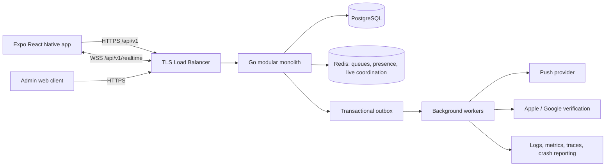
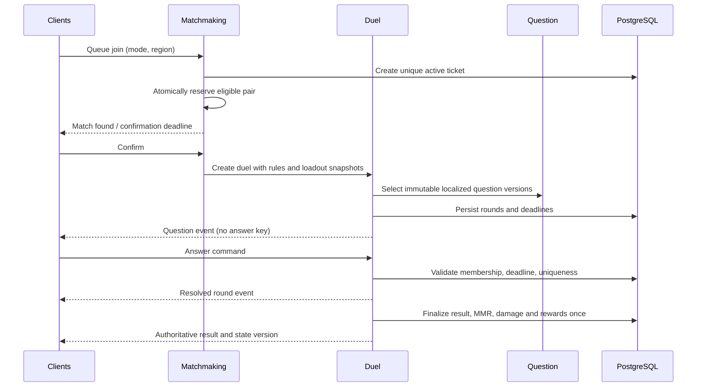
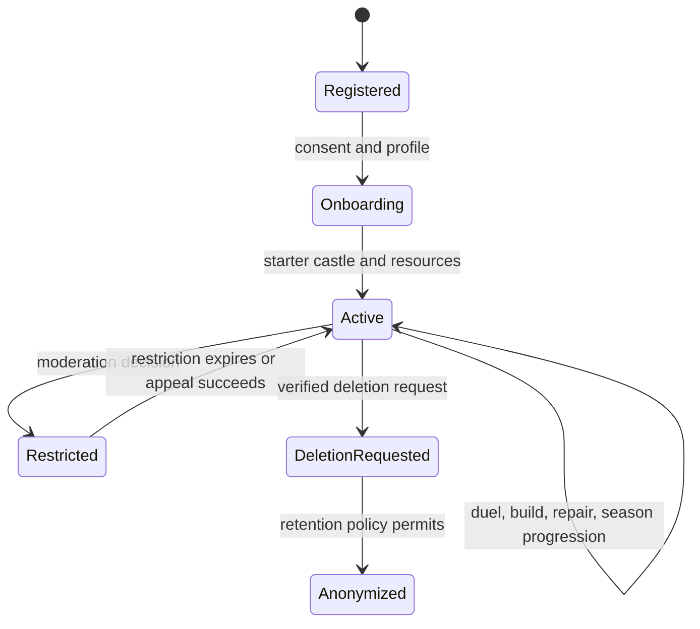
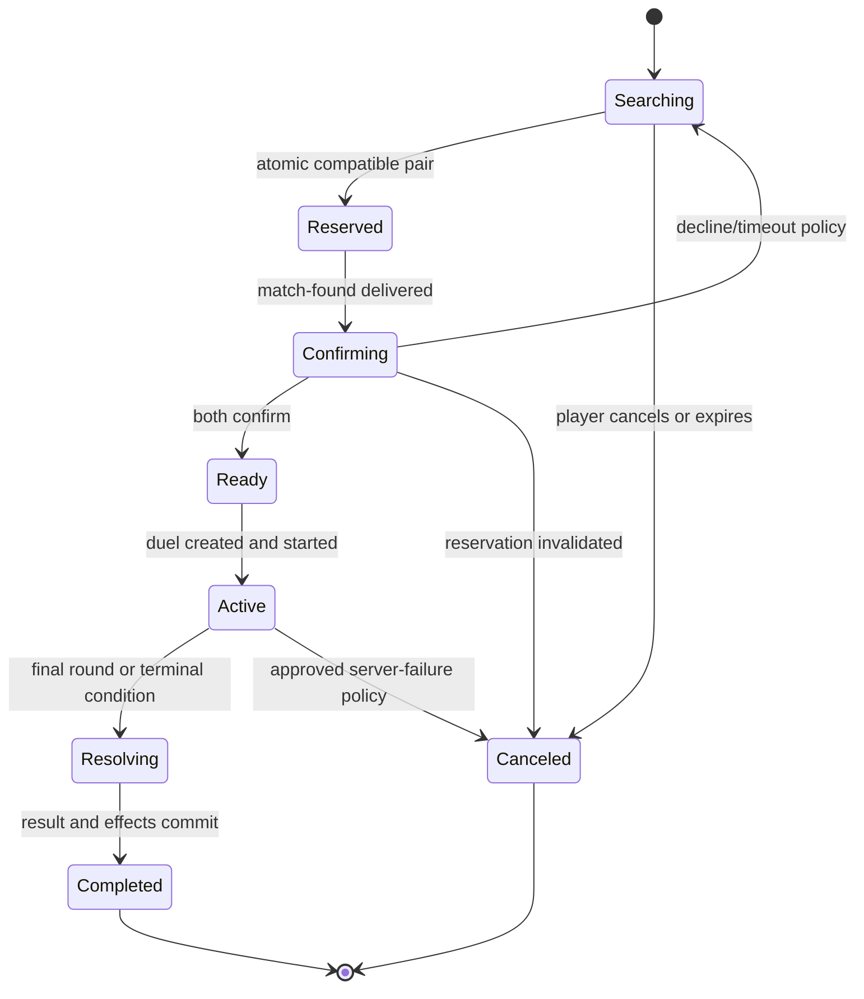
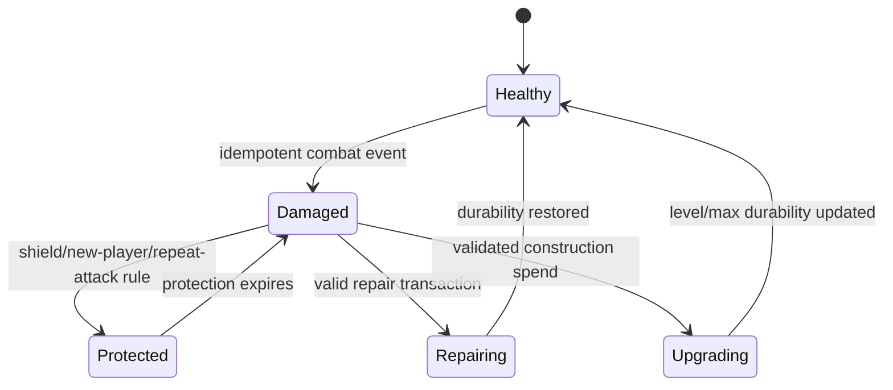
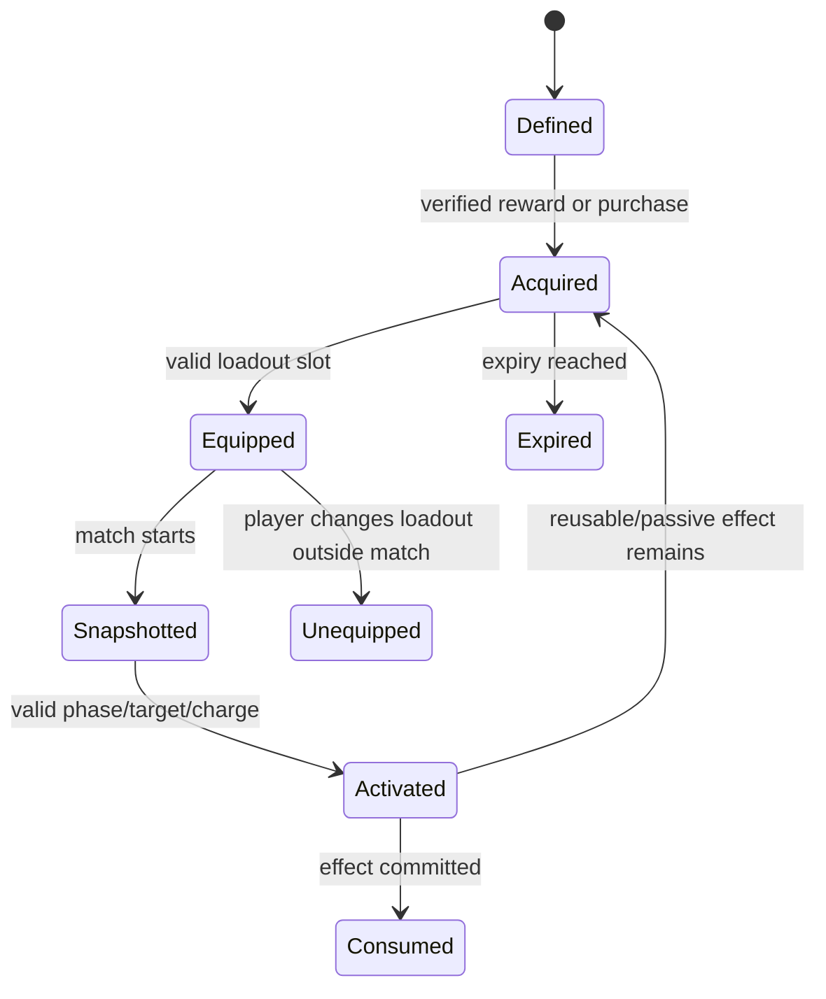
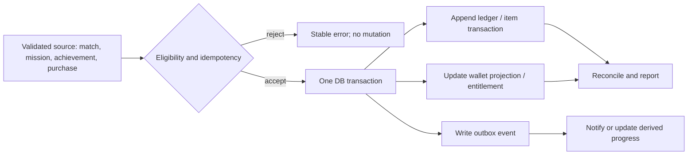

# Kale Düellosu System Architecture

## Status and source audit

This blueprint is derived from the eight source documents in `docs/` (PRD, game design, UI/UX, architecture, database, API/WebSocket, economy, and roadmap/admin/QA/release), read in full. Those documents are the product baseline. This file set does not modify them.

The source specifies iOS/Android, Turkish-first localization, ranked automatic matchmaking and unranked direct friend challenges in the initial public release. The product also requires a persistent, repairable castle, question duels, abilities, player progression, social safety, competitive seasons, and auditable economy operations.

### Source conflicts and decisions to validate

| Topic | Source evidence | Architecture planning decision |
|---|---|---|
| Combat winner | PRD/GDD allow unresolved choice between winner-only damage and both players inflicting damage based on earned attack points. | Make the resolver configurable. Default recommendation: bounded damage for both based on earned attack points, plus a small winner bonus; decide and playtest before ranked launch. |
| Tie | GDD suggests sudden death, then draw; PRD asks for a configured policy. | Plan sudden death with same server-authoritative flow, then draw; keep ranked draw rating treatment separately configurable. |
| Duel delivery | Architecture permits WebSocket or REST answers; API specifies both REST and WebSocket paths. | WebSocket is the normal live path; REST is a guarded fallback sharing the same command handler and idempotency semantics. |
| Currency authority | Database says wallet is materialized and ledger authoritative; economy says reconcile totals. | Ledger is audit authority; wallet is a transactionally maintained projection, reconciled by a job. |
| Castle durability | Castle and structure rows both carry durability; combat includes structure targeting and overall durability. | Track structure durability and aggregate castle durability as explicitly defined aggregate values; one transaction updates both when a structure is hit. Never let combat delete a structure or its level. |
| API auth notation | API source has a malformed masked token description. | Use short-lived bearer access tokens and rotating, hashed refresh tokens; confirm the selected token format/provider. |
| MVP/P1 boundary | Product calls leagues/seasons mostly P1, but MMR is required for fair P0 matchmaking. | Ship a minimal hidden/internal MMR and matchmaking rating display in P0; ship public leagues, seasons, and full leaderboards in P1. |
| Platform identity and child safety | Auth providers, territory, and age policy are not selected. | Keep identity-provider adapters and compliance gates; resolve launch territories, age rating, parental-safety obligations, and account deletion before store submission. |

### Missing specifications and risks

- Exact ranked rules, damage model, ability roster/effects, loadout caps, reward amounts, league thresholds, season duration, matchmaking bounds, and protection parameters need approved versioned configuration and playtests.
- Question moderation workflow, content licensing, localization QA, reporting escalation, and answer-key access are not fully specified.
- Account deletion conflicts with retaining fraud-prevention, purchase, and competitive audit records; define legally compliant anonymization/retention by territory.
- Match persistence/recovery, multi-instance WebSocket ownership, timer scheduling, Redis failure behavior, and deployment hosting need a measurable load profile and provider choice.
- Purchases, refunds, and entitlement revocation need platform-specific policy, sandbox accounts, and reconciliation ownership.
- Source schema has no complete admin permission matrix, social privacy model, notification preference model, configuration history rules, active-match uniqueness constraint, or event retention policy.
- Exact API payload schemas, pagination conventions, event acknowledgment/replay semantics, rate limits, and error details need a versioned OpenAPI and event schema.

## Architecture summary

Use a TypeScript Expo / React Native mobile application and a Go modular monolith with PostgreSQL as the durable source of truth. Redis supports ephemeral queue coordination, presence, and recoverable live state but never owns balances, inventory, final results, or rating. The Go deployment serves REST and authenticated WebSockets; background workers process outbox events, notifications, season jobs, and reconciliation. Keep module interfaces explicit and deploy together initially.

## Component and domain boundaries

| Module | Owns | Core dependencies and boundaries |
|---|---|---|
| Auth | identities, sessions, refresh/revocation | Adapters for providers; provides authenticated principal |
| Player | profiles, privacy, statistics, deletion workflow | Reads match/progression projections; never exposes private identity fields |
| Question | localized, versioned content, review/publication | Duel consumes immutable published versions; answer keys stay server-side |
| Duel | match state, rounds, answers, score, finalization | Calls question, combat, rating, reward and castle domain interfaces within a defined transaction boundary |
| Realtime | WebSocket authentication, subscriptions, sequencing, snapshot sync | Transport only; gameplay commands route to domain handlers |
| Matchmaking | queues, candidate policy, reservations, confirmations | Uses trusted rating, region, block and availability data; reservation is concurrency-safe |
| Castle / Construction | castle and structure state, build, upgrade, repair | Economy ledger and castle update commit atomically |
| Combat | ability validation, attack/defense/damage resolution | Uses match-start loadout/config snapshots; idempotent combat event |
| Economy / Inventory | wallet projection, immutable ledgers, item ownership/use | No client-set balances/effects; unique idempotency keys |
| Progression / League / Season | XP, MMR, league, missions, achievements, seasonal rewards | Processes validated domain events; grants are idempotent |
| Social | friends, requests, blocks, invitations, reports | Enforces privacy and block rules before invitations/matching |
| Store / Purchase | catalog, receipt verification, entitlements, refunds | Verifies through platform; unique platform transaction fulfillment |
| Notification | inbox, preferences, push dispatch | Outbox-fed, at-least-once delivery with deduplication |
| Admin | privileged tools, configuration, moderation, audit | Separate role checks, MFA, reason capture, immutable audit |
| Analytics | privacy-filtered events and metrics | Asynchronous and non-authoritative |

Modules own their tables and business rules. Cross-module calls use typed interfaces in-process; do not make modules reach into each other's repositories. Keep transaction orchestration in the application/domain use case that owns the business operation. Avoid circular imports.

## State and consistency boundaries

- PostgreSQL is authoritative for identities, profiles, castles, inventory, balances/ledger, questions, match results, MMR, purchases, and audit history.
- Redis queue tickets are ephemeral coordination plus durable ticket metadata in PostgreSQL. Rebuild/reconcile queue state after Redis loss.
- Live duel state has a durable match/round record and sequence/checkpoint sufficient to recover after process restart. Redis/memory are acceleration, not sole evidence for a final result.
- Critical multi-entity operations use one database transaction and unique constraints: match finalization, reward grants, castle damage, repair/build/upgrade, item use, purchase fulfillment, and claims.
- Outbox rows are committed with domain changes. Delivery can repeat; consumers deduplicate by event ID.
- Derived statistics, leaderboards, and wallet totals are rebuildable projections with reconciliation checks.

## Principal flows

### Ranked duel

### Friend challenge

Use Social to authorize a friend/block relationship and expire an invitation. On acceptance, invoke the same reservation and duel creation path as ranked matchmaking, but snapshot friendly mode rules; by default do not modify MMR/leaderboards. Friendly rewards are configurable and anti-farm limited.

### Castle / economy mutation

The API validates current version, ownership, prerequisites, and idempotency key. In a single transaction it locks or compare-and-swaps the relevant castle/wallet projection, inserts immutable debit/credit ledger entries, updates the projection and castle state, then writes an outbox event. A retry returns the prior outcome.

## Security and trust boundaries

All clients, including authenticated ones, are untrusted. Client clock, score, correctness, damage, MMR, wallet, inventory, purchase success, and match outcome are never authoritative. Enforce authorization at every command and subscription; rate-limit by account/device/IP as appropriate; do not put answer keys or secrets in client payloads. Privileged admin flows require MFA, least privilege, reason capture, and audit. See `07_SECURITY_AND_ANTICHEAT.md`.

## MVP versus later scale

**MVP:** one Go application deployment (horizontally replicated), managed PostgreSQL, Redis, worker process, HTTPS/WSS load balancer, push and store adapters, central telemetry, CI/CD, backups and tested restore. No service mesh, event broker, warehouse, or microservice split is required at launch.

**Scale when measured:** isolate WebSocket gateway or workers, partition matchmaking by region, add read replicas/caches, move analytics to a warehouse, partition/archive high-volume event history, or split a module only when load, ownership, or fault isolation justifies operational cost.

## Decisions to close before implementation

Approve gameplay policy/config values; target launch territories and privacy/age obligations; identity and hosting providers; answer submission transport and fallback; expected concurrency and latency profile; season and purchase/refund rules. Keep all tunable game values in versioned server configuration and snapshot them into active matches.

## Lifecycle models

Player roles are `player`, `moderator`, `support`, `designer`, `analyst`, and `super_admin` with role-specific least-privilege permissions. Player sessions never imply admin permission. Admin identities use separate authentication/MFA and every sensitive action is audited.
