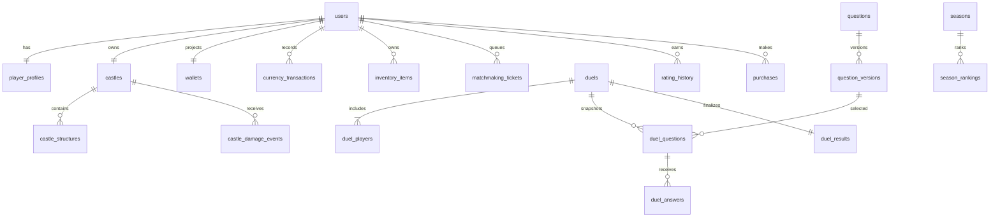

# Database Design

## Conventions and relationship model

PostgreSQL is the durable source of truth. Use UUID IDs, UTC `timestamptz`, integer score/damage/currency units, explicit constrained statuses, version columns for optimistic concurrency, foreign keys, and versioned SQL migrations. Retain financial, match, moderation and audit history under an explicit privacy/retention policy.

## Core tables and rules

### Identity and player

- `users`: normalized unique username, status, nullable normalized email, deletion/verification timestamps; never plaintext password.
- `user_identities`: provider and provider subject unique pair.
- `user_sessions`: user, refresh-token hash, expiry, revocation; rotation invalidates prior credential.
- `player_profiles`: level/XP, avatar, locale, privacy settings.
- `player_statistics`: rebuildable counters and aggregate response time.

Private email, provider subject, refresh token hash, and account state are never exposed by public profile queries.

### Castle and combat

- `castles`: unique owner, level, aggregate durability/max, defense rating, theme, protection, version.
- `structure_definitions`: versioned/configurable unlock, cost, durability, defense and asset rules.
- `castle_structures`: castle, definition, level, durability/max, slot, status, version; unique `(castle_id, slot_key)`.
- `castle_damage_events`: castle/optional structure, duel, attacker, integer damage, unique combat event ID.
- `castle_repairs`: owner, target, restored durability, cost snapshot, unique user-scoped idempotency key.

Decision: structure durability is the damage target. Aggregate castle durability is a maintained sum or explicit core value—choose one in the schema ADR and enforce it consistently. No combat event removes level or structure ownership. Applying damage updates the target and aggregate in one transaction.

### Duel and questions

- `duels`: mode/status/winner/result type, rules snapshot, start/end.
- `duel_players`: participant, rating snapshots, score/correct count/response duration, ready/connection state; unique `(duel_id,user_id)`.
- `questions` and `question_versions`: category, type, difficulty, publication state and immutable localized prompt/options/answer key; unique `(question_id,version,locale)`.
- `duel_questions`: immutable selected question version, round, server deadline/resolution; unique `(duel_id,round_number)`.
- `duel_answers`: server-received payload/time/duration, correctness and score; unique `(duel_question_id,user_id)`.
- `duel_results`: one per duel, result payload and unique finalization key.

Enforce exactly two participants and at most one active duel per user with transactional reservation plus a durable active-participation/lease constraint strategy. A partial unique index over active states may be used if lifecycle status is modeled directly; test status transitions and crash recovery.

### Matchmaking and social

- `matchmaking_tickets`: user, mode, trusted rating/league/castle power/region snapshot, status and expiry; partial unique index on active ticket per user.
- `matchmaking_matches`: candidate tickets, confirmation deadline/status and resulting duel. Add uniqueness preventing ticket reuse and active user reservation; atomically claim both.
- `matchmaking_history`: outcome, opponent rating gap and wait duration.
- `friendships`: canonical user ordering, unique pair.
- `friend_requests`, `duel_invitations`: sender/recipient/status/expiry; indexes on recipient/status/expiry.
- `blocked_users`: unique blocker/blocked pair; enforce blocks in both invitation and matchmaking candidate policy.
- `player_reports`: reporter/target/reason/status/reviewer and restricted details.

### Economy, inventory and purchases

- `wallets`: current projection per user with integer balances and version.
- `currency_transactions`: immutable signed amount, currency, reason, reference and idempotency key. Unique `(user_id, operation_type, idempotency_key)`; global keys alone may collide across users.
- `item_definitions`, `inventory_items`, `inventory_transactions`: catalog effects and ownership; use a non-null canonical expiry bucket or a separate grant-lot table because ordinary unique constraints treat NULL specially.
- `ability_definitions`, `equipped_abilities`, `ability_usage_events`: server configuration, bounded slots and idempotent usage.
- `store_products`, `purchases`, `player_entitlements`: unique `(platform, platform_transaction_id)`; track pending/verified/refunded/revoked states and provenance.

The ledger is audit authority; wallet is updated atomically as a projection and reconciled. Use compensating entries, never edit/delete a posted transaction.

### Progression, content, admin and operations

- `leagues`, `rating_history`, `seasons`, `season_rankings`, `season_rewards`.
- `mission_definitions`, `player_missions`, `achievement_definitions`, `player_achievements`; claims have unique idempotency and reward source reference.
- `notifications` and `notification_preferences` (required addition for documented inbox/preferences).
- `admin_users`, role/permission assignments, `admin_audit_logs` with before/after, reason and request ID.
- `game_configurations`: immutable version history and active interval; matches snapshot active version.
- `outbox_events`: aggregate/event/payload/status/retry data, unique event ID.
- `idempotency_records`: actor, operation, key, request hash, response/status and expiry/tombstone.
- `match_event_log` or equivalent durable sequence/checkpoint store for replay/sync, with retention and partition strategy.

## Indexes and constraints

At minimum: unique normalized username/provider subject; active ticket per user; unique answer per participant/round; unique result per duel; unique transaction/purchase/idempotency keys; participant lookup `(user_id, duel_id)`; duel status/time; user ledger time; castle damage history; seasonal ranking `(season_id,rating DESC,user_id)` with stable tie-break; ticket status/rating/search time; outbox pending status/time; event sequence `(match_id,sequence)`. Index foreign keys and actual query predicates; verify with query plans.

## Transactions

1. **Match reservation:** atomic ticket claim for two users and active-match uniqueness.
2. **Answer:** lock/validate round and deadline, insert one answer; resolve once after both answers or timeout.
3. **Finalization:** one immutable result, MMR/history, castle damage, ledger/inventory/reward claims, statistics update, and outbox writes.
4. **Build/upgrade/repair:** verify version/prerequisites, debit and state mutation together.
5. **Ability use:** validate loadout/window/charge, consume item and store effect exactly once.
6. **Purchase:** verified unique platform transaction, entitlement/credit, audit/outbox together.
7. **Mission/season reward claim:** condition, unique claim, reward ledger and state in one transaction.

Use row locks or compare-and-swap versions; avoid long-running work inside transactions. External store/push calls happen outside DB transactions and are reconciled via durable state/outbox.

## Migration, backup and retention

Migrations are ordered, reviewed, forward-compatible for rolling deploy, and tested from empty DB plus recent staging-like data. Destructive migrations require backup, explicit approval, and an expand/migrate/contract sequence. Automated encrypted backups and point-in-time recovery are verified by restore drills. Define deletion/anonymization and retention by legal territory; partition/archive high-volume answer/event/ledger history only after measured volume and policy review.
