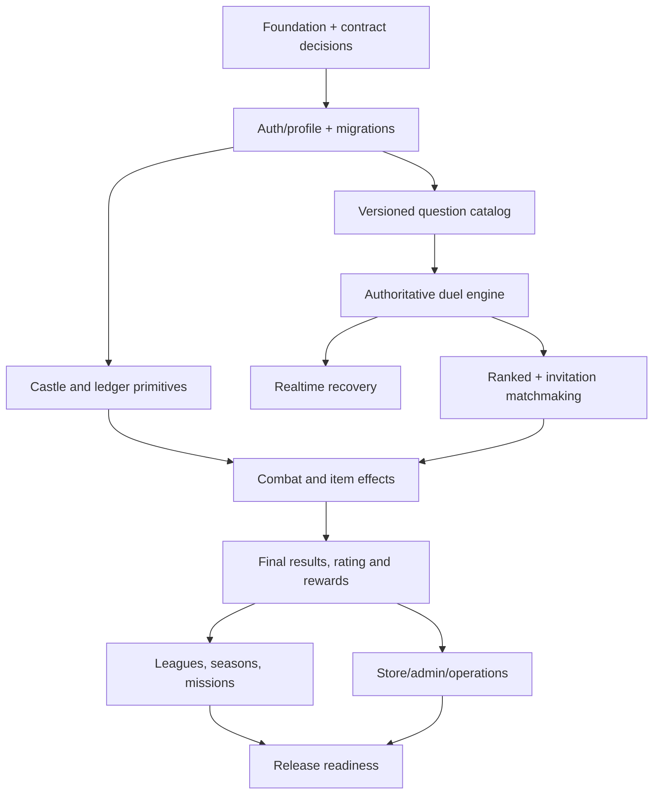
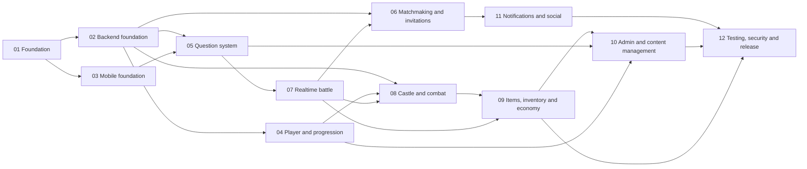

# Master Implementation Plan

## Strategy

Deliver a modular monolith in integrated vertical slices. Start with repository/tooling and contract decisions, establish identity and persistence, then deliver a working persistent castle, question duel, both required matchmaking paths, combat/economy consistency, and P1 retention/monetization/admin systems. Do not build disconnected static screens ahead of a tested end-to-end match loop.

The eight documents in `docs/` are the product baseline. Architecture documents in `docs/architecture/` are the implementation design. Task IDs below are stable identifiers; preserve them when tasks move between phases.

## Phases and milestones

| Phase | Objective and included task files | Dependencies | Deliverables / exit criteria |
|---|---|---|---|
| 0. Decisions & foundation | `01_PROJECT_FOUNDATION`, initial ADRs | Product owner decisions listed in architecture | Repository conventions, CI, local DB/Redis, contracts and migration baseline |
| 1. Identity and app shell | `02_BACKEND_FOUNDATION`, `03_MOBILE_FOUNDATION` | Phase 0 | Register/login/refresh, profile, app routes, typed API and secure session |
| 2. Castle and economy vertical slice | `08_CASTLE_AND_COMBAT_SYSTEM` (castle foundation), `09_ITEMS_INVENTORY_AND_ECONOMY` (ledger/wallet), progression profile tasks | Phase 1 | Persistent starter castle; safe wallet, build, upgrade and repair |
| 3. Question/content foundation | `05_QUESTION_SYSTEM`, admin question subset | Phase 1 | Approved versioned question content and answer-key-safe selection |
| 4. Authoritative duel | `07_REALTIME_BATTLE_SYSTEM` | Phases 1 and 3; castle/economy interfaces agreed | Two clients finish duel; synchronized rounds, score, reconnect, immutable result |
| 5. Ranked and friend entry | `06_MATCHMAKING_AND_INVITATIONS`, `11_NOTIFICATIONS_AND_SOCIAL` | Phase 4; profile/MMR baseline | Atomic ranked pairing and direct friend invitation use same duel engine |
| 6. Combat and full rewards | Remaining castle, inventory/economy, progression tasks | Phase 4-5 | Damage/defense/item flow and match finalization are transactional and idempotent |
| 7. Competitive/retention P1 | progression leagues/seasons/missions, notifications, shared reward claims | Phase 6 | Leaderboards, season lifecycle, missions, idempotent claims and notifications |
| 8. Store/admin/launch | admin, purchases, security/testing/release | Phase 7 plus platform/legal decisions | Admin operations, verified store flow, release gates, operational readiness |

### Phase task groups

| Phase | Required task IDs (in addition to prerequisites) | Completion criteria |
|---|---|---|
| 0 | FOUND-01..FOUND-05, RELEASE-01 | Toolchain, ADRs, local services, CI and contract/migration conventions pass |
| 1 | BACK-01..BACK-05, MOB-01..MOB-04, PROG-01 | Secure identity/profile and app shell work end-to-end |
| 2 | BACK-06..BACK-07, CASTLE-01..CASTLE-03, ECON-01..ECON-02, MOB-06, MOB-08 | Persistent castle and transactional wallet operations pass |
| 3 | QUES-01..QUES-03, QUES-06, ADMIN-01..ADMIN-03 (content backend/UI may land in staged increments) | Reviewed immutable question versions can be selected safely |
| 4 | QUES-04..QUES-07, BACK-08, BATTLE-01..BATTLE-05, BATTLE-07, BATTLE-10, MOB-05, MOB-07 | Two-player synchronized duel with answer validation and reconnect |
| 5 | MATCH-01..MATCH-08, SOC-01..SOC-04, MOB-11 | Ranked queue and direct friend invitation both start the shared duel |
| 6 | CASTLE-04..CASTLE-09, ECON-03..ECON-05, ECON-10, BATTLE-06, BATTLE-08..BATTLE-09, PROG-02..PROG-03, PROG-09 | Damage, ability, reward, XP and rating outcomes are authoritative and idempotent |
| 7 | ECON-06, PROG-04..PROG-08, SOC-07, MOB-10 | Public competitive progression, idempotent claims, missions and notification flows are complete |
| 8 | ECON-08..ECON-09, ADMIN-04..ADMIN-08, SOC-05..SOC-06, RELEASE-02..RELEASE-14 | Security, purchase, admin, compliance and operations release gates pass |

## Critical path

Foundation, mobile UI tokens, question authoring UX, admin RBAC design, and environment/observability setup can proceed in parallel after interfaces and task dependencies are respected. Duel correctness, ledger/finalization, and queue reservation require centralized backend coordination.

## Milestones

1. **Foundation verified:** reproducible local environment, CI and migration workflow.
2. **Account verified:** secure registration/session and profile on two clients.
3. **Progression slice verified:** castle and economy survive reinstalls; concurrent mutation tests pass.
4. **Duel verified:** two physical/simulated clients finish a synchronized match with server-determined results and reconnect recovery.
5. **Entry paths verified:** ranked and direct friend challenges both create the same duel type; duplicate assignment and block tests pass.
6. **Competitive loop verified:** damage/repair/rewards/MMR are consistent and idempotent.
7. **Public release candidate:** P1 features, store/admin/compliance, monitoring, restore drill and release gates pass.

## MVP completion criteria

All PRD MVP/P0 requirements are implemented; both ranked matchmaking and direct friend challenge work; match state recovers after supported transient disconnects; server owns all competitive/economic decisions; persistent castle damage is recoverable; duplicate answer/reward/purchase operations do not duplicate effects; account deletion, reporting/blocking, security tests and operational monitoring are present. P1 first-public-release requirements (leagues/seasons/missions, store/purchases, notifications, moderation/admin, analytics and release readiness) must also be complete before public launch as defined by the PRD.

## Risks and required decisions

- Product decisions: match length/timer, speed bonus interpretation, tie and draw rating policy, mutual versus winner-only damage, ability effects/ranked caps, friendly rewards, protection/recovery, resource values, season rules and matchmaking limits.
- Engineering: latency fairness, durable timers and recovery, queue reservation race, concurrent castle operations, transaction scope and transaction volume.
- Operations: concurrency/load envelope, hosting/regions, Redis-loss response, data residency, RPO/RTO, purchase and push provider availability.
- Compliance/safety: age rating/child requirements, data deletion/retention, platform policies, question/media rights and moderation operations.

## Execution and completion policy

Every task includes implementation steps, dependencies, expected modules, contract/data impact, measurable acceptance criteria, tests, and completion evidence. Dependencies are recorded in the Mermaid graph below each task group and reflected in each task. Mark a task done only after code, migration/contracts, automated tests, review, and staging evidence exist. Architectural decisions are centralized in reviewed ADRs; independent UI/content work may be delegated only with stable contracts.

## Dependency graph

## Task catalog and coordination

| Task file | ID prefix | Phase / parallelism guidance |
|---|---|---|
| `01_PROJECT_FOUNDATION.md` | FOUND | Phase 0; central repository/contract decisions |
| `02_BACKEND_FOUNDATION.md` | BACK | Phase 1; central auth/data boundaries |
| `03_MOBILE_FOUNDATION.md` | MOB | Phase 1; parallel after API/auth contracts |
| `04_PLAYER_AND_PROGRESSION.md` | PROG | Profile/XP independently; MMR depends on match finalization |
| `05_QUESTION_SYSTEM.md` | QUES | Catalog and admin draft UI parallel after schema/contracts |
| `06_MATCHMAKING_AND_INVITATIONS.md` | MATCH | Reservation and duel-engine integration centrally coordinated |
| `07_REALTIME_BATTLE_SYSTEM.md` | BATTLE | Critical path; one owner for state machine/finalization |
| `08_CASTLE_AND_COMBAT_SYSTEM.md` | CASTLE | Castle CRUD parallel; combat waits on battle/economy contracts |
| `09_ITEMS_INVENTORY_AND_ECONOMY.md` | ECON | Ledger is centralized; catalog/admin UI can parallel |
| `10_ADMIN_PANEL_AND_CONTENT_MANAGEMENT.md` | ADMIN | Admin shell parallel; mutation permissions centrally reviewed |
| `11_NOTIFICATIONS_AND_SOCIAL.md` | SOC | Friend/block precede invitations; delivery can parallel after outbox |
| `12_TESTING_SECURITY_AND_RELEASE.md` | RELEASE | Test design starts early; release gates complete last |

## First tasks to execute

Start with `FOUND-01` (repository/toolchain inventory and structure decision), `FOUND-02` (contract/configuration and ADR decisions), and `FOUND-03` (local services/CI baseline). In parallel, product/design can close unresolved ranked gameplay parameters and design can prototype Home, matchmaking, duel, combat, result, workshop, league and store screens. Do not start implementation of combat formulas or ranked rewards until policy values are approved.

## Parallel agent suitability

**Suitable for parallel implementation after contracts are frozen:** MOB-02 design system; PROG-01 profile/read model; QUES-01 catalog schema; QUES-02 authoring use cases after RBAC contract; MOB-06 home shell; SOC-01 friend-request UI/API after privacy rules; ADMIN-02 shell after RBAC; RELEASE-08 load harness. Keep changes in separate owned modules and merge only after contract tests.

**Keep under centralized technical coordination:** FOUND-02 gameplay/API/data ADRs; BACK-04 transaction/migration conventions; MATCH-03 atomic reservation; BATTLE-01 state machine and BATTLE-08 finalization; ECON-01 ledger; CASTLE-04 damage consistency; ADMIN-05 live configuration activation; purchase fulfillment and production release. Parallel contributors may implement isolated adapters/tests, but one owner approves invariants and integration.

## Effort scale

XS: hours; S: about 1-2 days; M: several days; L: about 1-2 weeks; XL: larger than a sprint or requires staged rollout. These are relative sizing labels, not delivery-date promises.
